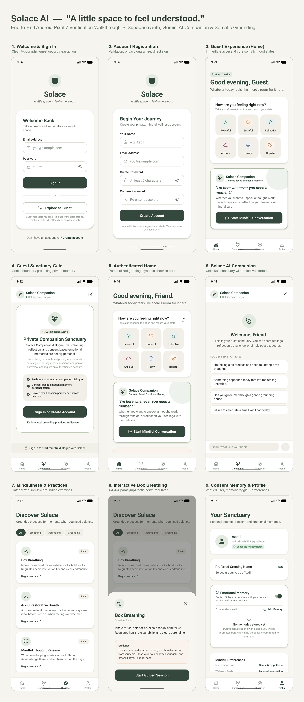

# Solace AI — Mobile Verification & Screen Gallery

> **"A little space to feel understood."**  
> A premium AI-powered wellness companion designed for mindful reflection, emotional grounding, and consent-based emotional memory.

## 🌐 Live Interactive Gallery
👉 **[View Interactive Web Gallery](https://aadil-lang.github.io/solace-ai-gallery/)**

---

## 📱 Mobile Verification Screens
This public repository hosts the end-to-end device verification screenshots captured on a Google Pixel 7 Android emulator (`emulator-5554`), showcasing:
- **Authentication**: Welcome, Sign In, and Registration screens with Supabase Auth.
- **Guest Experience**: Zero-barrier 6-mood tactile check-in grid and private sanctuary gating.
- **Authenticated Sanctuary**: Personalized daily greetings, companion conversations, and real-time streaming dialogue.
- **Mindfulness & Somatics**: Categorized grounding practices and interactive Box Breathing bottom-sheet modal.
- **Radical Consent**: Complete user sovereignty over AI emotional memory and preferences.

---

## 📥 Standalone Android Preview APK
- **EAS Build Status**: `FINISHED (SUCCESS)`
- **Direct APK Download**: [Download Solace APK (90.7 MB)](https://expo.dev/artifacts/eas/YZFgz1jEFCc7I7ZBaO5m262mV0R69NeDTaQXDW_sXYs.apk)

---

## 🖼️ Master 3x3 Presentation Collage

